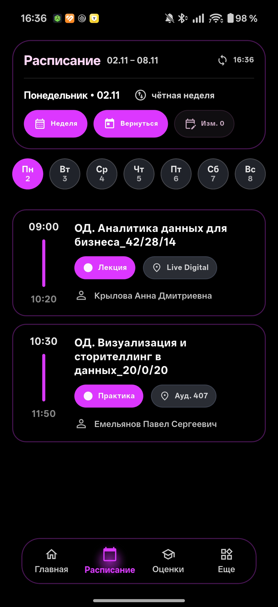
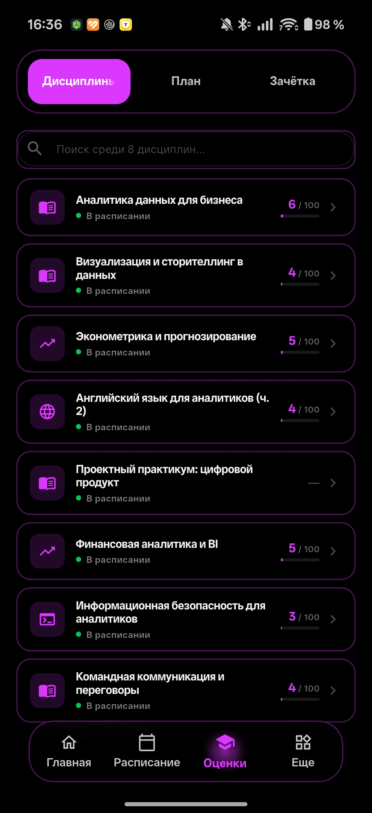
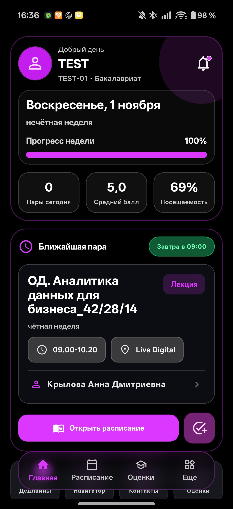

<div align="center">

# 🎓 My IMES

### Your personal study assistant in your pocket

[](https://github.com/VladosFlexXx/imes_app/releases/latest)
[](https://vladosflexxx.github.io/imes_app/app/)
[](docs/SECURITY_AUDIT_EN.md)
[](https://flutter.dev)
[](https://dart.dev)
[](LICENSE)


**Cross-platform application for IMES Students (Android, iOS & Web)**  
Schedule • Grades • Home • Notifications

[📥 Download APK](https://github.com/VladosFlexXx/imes_app/releases/latest) • [🌐 Open Web (PWA)](https://vladosflexxx.github.io/imes_app/app/) • [📲 Web Guide](docs/WEB_INSTALL_EN.md) • [🍏 iPhone (iOS) Guide](docs/IOS_INSTALL_EN.md) • [🛡️ MobSF Audit](docs/SECURITY_AUDIT_EN.md) • [🐛 Report a Bug](#-report-an-issue)

</div>

---

## ✨ Features

<table>
<tr>
<td width="50%">

### 📅 **Smart Schedule**
- ✅ Fast search across 45 days by subject, classroom, and teacher
- ✅ Export & share schedule (day / week) tailored for Telegram and messengers
- ✅ Automatic odd/even week detection
- ✅ Filtering by dates and week types
- ✅ Only relevant classes and schedules
- ✅ Clean calendar UI

</td>
<td width="50%">

### 🎯 **Grades & Progress**
- ✅ Modern grade cards by subject
- ✅ Automatic GPA calculation
- ✅ Element breakdown and grade details
- ✅ Direct sync with IMES portal

</td>
</tr>
<tr>
<td width="50%">

### 🏠 **Home Dashboard**
- ✅ Real-time upcoming class widget
- ✅ Smart evening mode ("All done for today 🎉", finish times and tomorrow overview)
- ✅ Quick jump to schedule and grades
- ✅ Semester progress and status overview
- ✅ Responsive dynamic cards

</td>
<td width="50%">

### 🔔 **Push Notifications & Themes**
- ✅ Schedule changes and new grade alerts
- ✅ Themes: Light, Dark, AMOLED, Liquid Glass
- ✅ Dynamic Material You colors & accents
- ✅ Launcher icon switcher (Light / Dark)

</td>
</tr>
</table>

---

## 🚀 Quick Start

### 📱 Android
1. **Download APK:**  
   Head to [GitHub Releases](https://github.com/VladosFlexXx/imes_app/releases/latest) and download `vuz_app-release.apk`.
2. **Allow installation from unknown sources** in your device's security settings.
3. **Install & sign in:**  
   Use your IMES portal credentials. Passwords are saved only locally in encrypted secure storage.

### 🌐 Web App (PWA — iPhone, Android & Desktop)
1. **Open directly:** Navigate to **[https://vladosflexxx.github.io/imes_app/app/](https://vladosflexxx.github.io/imes_app/app/)**.
2. **Install to Home Screen:**
   - **iPhone (Safari):** Tap *Share → "Add to Home Screen"* (runs in fullscreen standalone mode without browser bars).
   - **Android / Desktop (Chrome / Edge):** Click *Install App* in the browser address bar or menu.
   - 👉 **[Detailed Web (PWA) Guide](docs/WEB_INSTALL_EN.md)**

### 🍏 Apple iPhone (iOS IPA Sideload)
1. **Download IPA:**  
   Download the `MyIMES-*.ipa` bundle from [GitHub Releases](https://github.com/VladosFlexXx/imes_app/releases/latest).
2. **Install via Sideload:**  
   Follow our detailed step-by-step beginner guide:  
   👉 **[iOS Sideload Installation Guide (Sideloadly, Scarlet, TrollStore)](docs/IOS_INSTALL_EN.md)**.

> ⚠️ **Warning:** The app is currently in **BETA**. It is under active continuous development.

---

## 📸 Screenshots

<div align="center">

| Schedule | Grades | Home |
|:----------:|:------:|:-------:|
|  |  |  |

</div>

---

## 🛠 Technology Stack

<div align="center">

| Category | Technologies |
|:---------:|:-----------|
| **Frontend** |    |
| **Backend** |   |
| **CI/CD** |  |

</div>

---

## 📊 Project Status

```yaml
Version: 0.6.2 (beta)
Platform: Android / iOS (Sideload) / Web (PWA)
Status: Active Development
Last Update: November 07, 2026
```

<div align="center">

### 🔥 Development Activity


</div>

---

## 📝 Release Notes (Changelog)

### 🚀 v0.6.2 (Build 39) — 07.11.2026

- 🌐 **Web PWA: Retry & dart2js Compiler Collision Fix:** Resolved a minified compiler register aliasing bug in `dart2js` (`c.b is not a function`) that crashed the UI during network retries on course grade reports. Isolated delay helper logic and transitioned duration tracking from `Stopwatch` to `DateTime`.
- 🩺 **Web-Native Diagnostics:** Redesigned system diagnostic exporter to function seamlessly in Web environments without touching missing disk APIs — report generated in memory with one-tap clipboard copy and Web Share API integration.
- 💬 **Human-Readable Error Messages:** Converted technical network and session exceptions on the course report screen into helpful, student-friendly explanations.
- 🚀 **Web Bundle Update:** Rebuilt production web assets in `landing_preview/app/` for GitHub Pages continuous deployment.

### 🚀 v0.6.1 (Build 38) — 07.11.2026

- 🛡️ **MobSF Security Audit Release:** Published official MobSF v4.6.4 static application security testing audit (`docs/SECURITY_AUDIT_EN.md` & `docs/mobsf_report.pdf`): 0 trackers, 0 malware, strict HTTPS enforced.
- 🌐 **Web PWA:** Added fast-launch buttons for browser access and detailed step-by-step Home Screen installation guide for iPhone, Android, and PC (`docs/WEB_INSTALL_EN.md`).
- 📅 **Week Parity Synchronization:** Fixed week parity calculation discrepancies between the next lesson card and the main dashboard header, adopting unified `WeekParityService`.
- 📳 **Haptic Feedback (AppHaptics):** Integrated native haptic responses on grades tabs, schedule date pills, and lesson cards respecting the Settings toggle.
- 🎨 **Title Hub Redesign:** Complete refresh of `README.md` with interactive action badges, live platform statuses, and verified security metrics.

### 🚀 v0.6.0 (Build 37) — 04.11.2026

> ⚠️ **ATTENTION: UNINSTALL PREVIOUS VERSION BEFORE INSTALLING! WE CHANGED THE APPLICATION ID TO SU.IMES.APP, SO THIS VERSION CANNOT BE INSTALLED OVER THE OLD ONE. UNINSTALL THE APP FIRST AND INSTALL THE NEW APK CLEANLY FROM GITHUB.**

- 🏷 **Package ID Migration:** Official application identifier migrated to `su.imes.app` (Android applicationId/namespace, iOS Bundle Identifier, Dart package `imes_app`).
- 🖥 **Grades Desktop UI (Master-Detail):**
  - Two-pane layout (subject list on the left, full BRS breakdown of the selected course on the right).
  - Selected course highlighted with glowing neon accent, clean progress bars, and status indicators.
  - Removed misleading automated pass markers; now showing accurate points and direct progress.
  - Smart teacher auto-matching from schedule to grading records.
  - In-memory report cache for instant switching between subjects without waiting or spinners.
- 📅 **Schedule Desktop UI:**
  - 7-column weekly schedule overview (Mon — Sun) with compact lesson cards and classroom badges.
  - Top KPI status cards: "Today", "Next Class", "Free Windows".
- 🌐 **Network Gateway & Web:**
  - Cloudflare Workers fallback proxy and Smart Failover engine for reliable access across any VPN.
  - Updated production Web PWA release in `landing_preview/app/`.

---

## 🐞 Report an Issue

Found a bug? Help us improve the app!

### Reporting Steps:

1. 📱 Navigate to **Settings → Diagnostics**
2. 📦 Export a bug report (sanitized logs + cache + state)
3. 📤 Attach the report file and open an [Issue](https://github.com/VladosFlexXx/imes_app/issues/new)

> 💡 **Tip:** Diagnostic reports help us isolate and patch issues rapidly!

---

## 🗺 Roadmap

### ✅ Implemented (v0.3.x — v0.6.0)
- [x] Official Package ID migration to `su.imes.app` (Android, iOS, Dart)
- [x] Desktop Master-Detail grades view with active course highlighting and in-memory cache
- [x] Desktop 7-day schedule grid (Mon — Sun) with top KPI status cards
- [x] Core schedule and grading engine
- [x] Desktop dashboard layout (Bento Grid): navigation sidebar, topbar with Ctrl+K search, sync status & schedule timeline
- [x] Desktop UX Polish (v0.5.1): adaptive 2-3 column grades grid, two-column schedule layout with tomorrow's preview and full week glance, compact week selector, centered BRS detail view and profile screen
- [x] Web PWA: full VPN compatibility with Cloudflare Worker gateway & Smart Failover with Yandex Cloud
- [x] Web & Mobile: Back button in profile header (resolving navigation trap in web browsers)
- [x] Web: automatic haptic deactivation and switch removal in web browser settings
- [x] Refined student KPIs: "Lessons Today", "Lessons Tomorrow", and "Until Weekend" metrics replacing noisy GPA & attendance math
- [x] Web PWA client for iPhone and desktop without sideloading (works in RU without VPN and worldwide with VPN)
- [x] Custom color palette picker (Hue/Sat/Val sliders & HEX input) + 3 clean presets (IMES Orange, Violet, Green)
- [x] Updated team credits and university Easter eggs in the "About" dialog
- [x] Redesigned grades interface (modern cards, GPA, detail breakdown)
- [x] AppHaptics tactile feedback
- [x] Material You (Android), AMOLED, Liquid Glass, custom theme accents
- [x] Native light/dark app icon switching on Android
- [x] GitHub Actions automated iOS `.ipa` packaging
- [x] Comprehensive iOS Sideload installation guides
- [x] Secure silent relogin with instant credential cleanup on logout

### 🔨 In Progress (v0.5.x)
- [ ] Offline caching and background sync optimizations
- [ ] Offline schedule viewing
- [ ] Migration to 1C API backend instead of HTML scraping
- [ ] Full university ecosystem integration

### 🚀 Future Plans (v1.0+)
- [ ] RuStore / Google Play store distribution
- [ ] System calendar integration
- [ ] Schedule export (ICS)

---

## 🔐 Security & Privacy

> 🛡️ **Independent MobSF Audit:** The app underwent comprehensive static application security testing (SAST) in **Mobile Security Framework (MobSF)**. Verified: **0 trackers**, **0 malware**, strict **HTTPS enforced**.  
> 👉 **[Full Technical Security Audit Report (MobSF)](docs/SECURITY_AUDIT_EN.md)** • **[Download PDF Report](docs/mobsf_report.pdf)**

<table>
<tr>
<td width="33%" align="center">

### 🔒 **Authentication**
Direct authentication with IMES portal  
Encrypted secure credential store

</td>
<td width="33%" align="center">

### 🛡 **Privacy: 0 Trackers**
No third-party data tracking  
Hardware-backed Android Keystore

</td>
<td width="33%" align="center">

### 🔍 **Diagnostics**
No credentials or passwords collected  
Technical logs only

</td>
</tr>
</table>

---

## 🤝 Contributing

Contributions are welcome!

1. 🍴 Fork the repository
2. 🌿 Create your feature branch (`git checkout -b feature/AmazingFeature`)
3. 💾 Commit your changes (`git commit -m 'Add some AmazingFeature'`)
4. 📤 Push to your branch (`git push origin feature/AmazingFeature`)
5. 🎉 Open a Pull Request

---

## 📄 License

This project is distributed **without an open-source license**.  

**Use at your own risk** — intended for educational and testing purposes.

---

## 👨‍💻 Author

<div align="center">

**VladosFlexXx**

[](https://github.com/VladosFlexXx)

### Support the Project

⭐ **Leave a star** if you found this project helpful!

</div>

---

<div align="center">

### 📱 Launch & Install

[](https://github.com/VladosFlexXx/imes_app/releases/latest)
[-orange?style=for-the-badge&logo=googlechrome&logoColor=white)](https://vladosflexxx.github.io/imes_app/app/)
[-gray?style=for-the-badge&logo=apple&logoColor=white)](https://github.com/VladosFlexXx/imes_app/releases/latest)
[](docs/SECURITY_AUDIT_EN.md)

**Crafted with ❤️ for IMES Students**

</div>
