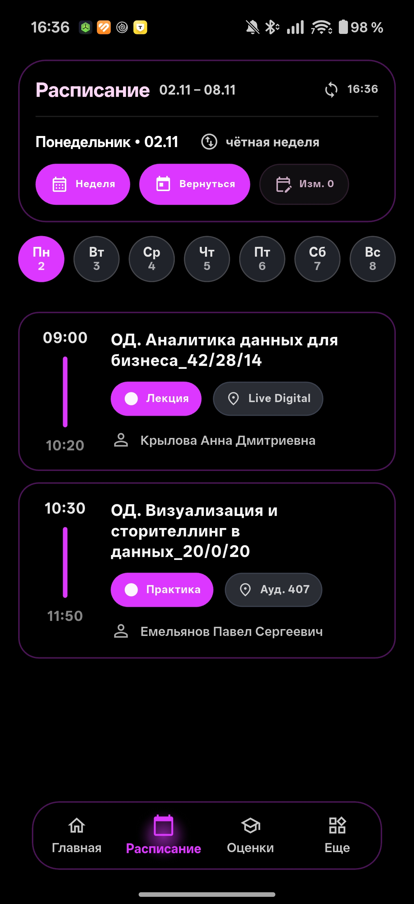
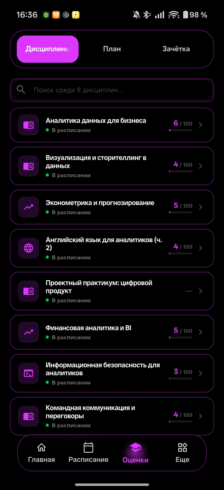
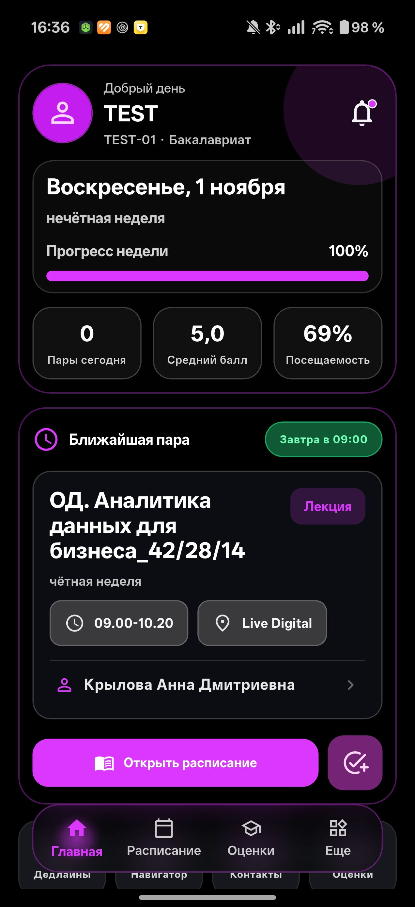

<div align="center">

# 🎓 Мой ИМЭС

### Твой личный помощник для учёбы в кармане

[](https://github.com/VladosFlexXx/imes_app/releases/latest)
[](https://flutter.dev)
[](https://dart.dev)
[](LICENSE)


**Мобильное приложение для работы с ЭИОС ИМЭС (Android & iOS)**  
Расписание • Оценки • Главный экран • Уведомления

[📥 Скачать APK](https://github.com/VladosFlexXx/imes_app/releases/latest) • [🍏 Инструкция для iPhone](docs/IOS_INSTALL_RU.md) • [📖 Документация](#-возможности) • [🐛 Сообщить о баге](#-сообщить-о-проблеме)

</div>

---

## ✨ Возможности

<table>
<tr>
<td width="50%">

### 📅 **Умное расписание**
- ✅ Мгновенный поиск по предметам, аудиториям и преподавателям (на 45 дней)
- ✅ Экспорт и шеринг расписания (день/неделя) для Telegram и чатов с красивым шаблоном
- ✅ Автоматическое определение чётной/нечётной недели
- ✅ Фильтрация по датам и типам недель
- ✅ Только актуальные предметы
- ✅ Красивый календарный вид

</td>
<td width="50%">

### 🎯 **Оценки и успеваемость**
- ✅ Текущие оценки по предметам в современном дизайне
- ✅ Автоматический расчёт среднего балла
- ✅ Детализация по элементам и срезам
- ✅ История изменений и прямая синхронизация с ЭИОС

</td>
</tr>
<tr>
<td width="50%">

### 🏠 **Главный экран**
- ✅ Виджет ближайшей пары в реальном времени
- ✅ Умный вечерний режим («Пары на сегодня всё 🎉», время до дома и превью на завтра)
- ✅ Быстрый переход к расписанию и оценкам
- ✅ Сводка статуса обучения
- ✅ Приятные динамические карточки

</td>
<td width="50%">

### 🔔 **Push-уведомления и темы**
- ✅ Уведомления об изменениях расписания и новых оценках
- ✅ Темы: светлая, тёмная, AMOLED, Liquid Glass
- ✅ Поддержка цветов Material You и динамических акцентов
- ✅ Переключение светлой/тёмной иконки приложения на рабочем столе

</td>
</tr>
</table>

---

## 🚀 Быстрый старт

### 📱 Android
1. **Скачайте APK:**  
   Перейдите в [GitHub Releases](https://github.com/VladosFlexXx/imes_app/releases/latest) и скачайте `vuz_app-release.apk`.
2. **Разрешите установку из неизвестных источников** в настройках безопасности телефона.
3. **Установите и войдите:**  
   Используйте ваши учётные данные от ЭИОС ИМЭС. Пароль сохраняется локально в защищённом хранилище.

### 🍏 Apple iPhone (iOS)
1. **Скачайте IPA:**  
   В [GitHub Releases](https://github.com/VladosFlexXx/imes_app/releases/latest) скачайте архив приложения `MyIMES-*.ipa`.
2. **Установите по инструкции:**  
   Ознакомьтесь с подробным пошаговым руководством для новичков:  
   👉 **[Инструкция по установке на iOS (Sideloadly, Scarlet, TrollStore)](docs/IOS_INSTALL_RU.md)**.

> ⚠️ **Внимание:** Приложение находится в **BETA**-версии. Активно развивается и дополняется.

---

## 📸 Скриншоты

<div align="center">

| Расписание | Оценки | Главная |
|:----------:|:------:|:-------:|
|  |  |  |

</div>

---

## 🛠 Технологический стек

<div align="center">

| Категория | Технологии |
|:---------:|:-----------|
| **Frontend** |    |
| **Backend** |   |
| **CI/CD** |  |

</div>

---

## 📊 Статус проекта

```yaml
Version: 0.4.1 (beta)
Platform: Android / iOS (Sideload)
Status: Active Development
Last Update: Ноябрь 2026
```

<div align="center">

### 🔥 Активность разработки


</div>

---

## 🐞 Сообщить о проблеме

Нашли баг? Помогите сделать приложение лучше!

### Шаги для репорта:

1. 📱 Откройте **Настройки → Диагностика**
2. 📦 Соберите отчёт (логи + кеш + состояние)
3. 📤 Отправьте файл или создайте [Issue](https://github.com/VladosFlexXx/imes_app/issues/new)

> 💡 **Совет:** Диагностический отчёт помогает быстрее найти и исправить ошибку!

---

## 🗺 Roadmap

### ✅ Реализовано (v0.3.x — v0.4.5)
- [x] Основной функционал расписания и оценок
- [x] Web PWA версия для iPhone и любых устройств без установки (работает в РФ без VPN)
- [x] Редизайн экрана оценок (карточки, средний балл, детализация)
- [x] Тактильный отклик (AppHaptics)
- [x] Темы: Material You, AMOLED, Liquid Glass, кастомные акценты
- [x] Переключение светлой/тёмной иконки на Android
- [x] Сборка iOS `.ipa` через GitHub Actions
- [x] Подробные инструкции по установке на iPhone (Sideload)
- [x] Безопасный тихий релогин и очистка хранилища при выходе

### 🔨 В разработке (v0.5.x)
- [ ] Оптимизация кеша и фоновых обновлений
- [ ] Офлайн-режим расписания
- [ ] Переезд на прямое API 1С вместо парсинга ЭИОС
- [ ] Полная интеграция в экосистему института

### 🚀 Планы (v1.0+)
- [ ] Публикация в RuStore / Google Play
- [ ] Интеграция с системным календарем
- [ ] Экспорт расписания

---

## 🔐 Безопасность и приватность

<table>
<tr>
<td width="33%" align="center">

### 🔒 **Авторизация**
Через официальный ЭИОС  
Безопасное хранение токенов

</td>
<td width="33%" align="center">

### 🛡 **Данные**
Данные не передаются третьим лицам  
Локальное шифрование

</td>
<td width="33%" align="center">

### 🔍 **Диагностика**
Без паролей  
Только техническая информация

</td>
</tr>
</table>

---

## 🤝 Вклад в проект

Хотите помочь? Отлично!

1. 🍴 Форкните репозиторий
2. 🌿 Создайте ветку для фичи (`git checkout -b feature/AmazingFeature`)
3. 💾 Закоммитьте изменения (`git commit -m 'Add some AmazingFeature'`)
4. 📤 Запушьте в ветку (`git push origin feature/AmazingFeature`)
5. 🎉 Откройте Pull Request

---

## 📄 Лицензия

Проект распространяется **без открытой лицензии**.  

**Использование на свой риск** — исключительно для обучения и тестирования.

---

## 👨‍💻 Автор

<div align="center">

**VladosFlexXx**

[](https://github.com/VladosFlexXx)

### Поддержать проект

⭐ **Поставьте звезду,** если проект был полезен!

</div>

---

<div align="center">

### 📱 Скачать сейчас

[](https://github.com/VladosFlexXx/imes_app/releases/latest)
[-gray?style=for-the-badge&logo=apple&logoColor=white)](https://github.com/VladosFlexXx/imes_app/releases/latest)

**Сделано с ❤️ для студентов ИМЭС**

</div>
