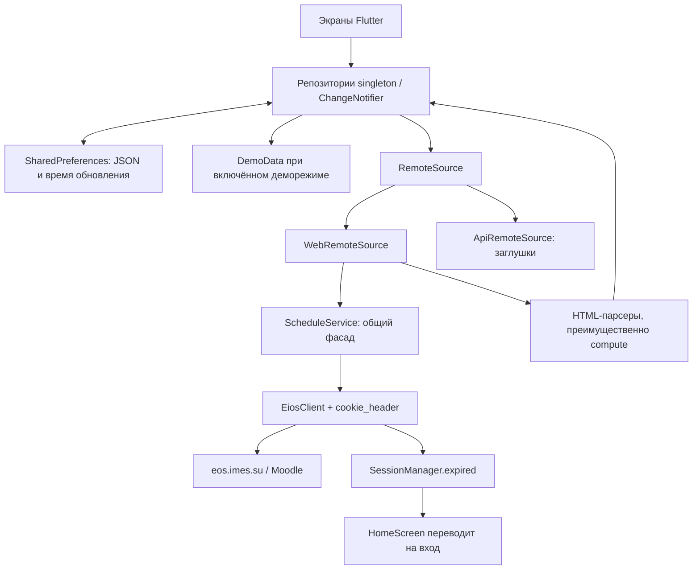

# Карта приложения «Мой ИМЭС»

Статический разбор локального репозитория от 31.10.2026. Версия в pubspec.yaml: 0.3.6+24, Dart SDK ^3.10.7. В lib — 100 Dart-файлов, около 15,7 тыс. строк. Это карта исходников и обнаруженных связей, а не подтверждение работоспособности сборки или внешних сервисов.

## Состав репозитория

| Путь | Назначение |
|---|---|
| lib/main.dart | Точка входа, перехват ошибок, запуск UI и отложенный запуск push |
| lib/app.dart | MaterialApp, маршруты, тема, версия и подготовка первого экрана |
| lib/core | Сессия, HTTP, общий кэш, выбор источника, демоданные, логи |
| lib/features | Экраны, предметные модели, репозитории и парсеры |
| lib/ui | Общая тема Material и shimmer-заглушки |
| lib/platform | MethodChannel для Android night mode |
| android | Основная платформенная сборка, Firebase, Kotlin-мост темы |
| ios, macos, linux, windows, web | Платформенные оболочки Flutter; наличие папок не означает готовность этих версий |
| assets | Иконка и изображения заставки |
| landing_preview | Отдельный статический сайт HTML/CSS/JS |
| config/push_bootstrap.json | Конфигурация внешнего сервера уведомлений |
| .github/workflows | Публикация лендинга и сборка APK |
| test/widget_test.dart | Widget-тесты StartupGate: быстрый/долгий старт, повтор, dispose |
| lib.zip | Дополнительный архив исходников, 69 записей; не участвует в импортах приложения |
| pubspec.yaml / pubspec.lock | Зависимости, версия, ресурсы / зафиксированные версии пакетов |

Собственного backend, Dockerfile, схемы серверной БД или кода push-сервера в этом репозитории нет.

## Запуск и навигация

1. main устанавливает обработчики FlutterError и PlatformDispatcher, перенаправляет debugPrint в AppLogger и запускает VuzApp.
2. VuzApp параллельно загружает тему, настройки авторизации, флаг деморежима и версию.
3. StartupGate (lib/ui/startup_gate.dart) показывает GIF во время подготовки. Сначала загружаются настройки и кэши расписания, оценок, профиля, плана, зачётки и уведомлений. Минимального времени заставки нет.
4. Без MoodleSession готовится экран входа. Для авторизованного пользователя до главной обновляются устаревшие расписание, оценки и профиль; свежий кэш используется сразу. В деморежиме эти наборы обновляются принудительно. Если при загрузке обнаружена истёкшая сессия, готовится вход. При сетевых ошибках сохраняются кэшированные данные. Первый экран отрисовывается под заставкой; после endOfFrame она исчезает за 250 мс. Неожиданная ошибка подготовки показывает кнопку повтора.
5. HomeScreen содержит IndexedStack с четырьмя вкладками: Главная, Расписание, Оценки, Ещё. Вкладки создаются при первом посещении и сохраняют состояние.
6. После StartupGate главная получает initialDataReady и не повторяет отложенную загрузку или вступительную анимацию карточек. При прямом входе в HomeScreen из WebView сохраняется прежняя отложенная загрузка. Искусственный таймер скелетона главной удалён. Остальные вкладки догружаются при посещении. TTL проверяется при вызове refresh, самостоятельного периодического обновления базовый репозиторий не запускает.
7. Профиль, настройки, центр уведомлений и отчёт дисциплины открываются через Navigator/MaterialPageRoute.

## Поток данных и состояние

Нет BLoC, Riverpod, Provider или контейнера зависимостей. Основное состояние хранится в singleton-репозиториях, ChangeNotifier/ValueNotifier; локальное состояние экранов — setState. UI подписан через AnimatedBuilder и Listenable.merge.

CachedRepository предоставляет data, loading, lastError, updatedAt; объединяет одновременные init/refresh; при ошибке сети сохраняет предыдущие данные. Кэш сериализуется вручную. SQLite/Drift/Hive не используются.

| Репозиторий | Модель | TTL | Источник |
|---|---|---|---|
| ScheduleRepository | List<Lesson> | 10 минут | Основная таблица + изменения |
| GradesRepository | List<GradeCourse> | 15 минут | Обзор оценок Moodle |
| ProfileRepository | UserProfile? | 2 часа | /my/, профиль и форма редактирования |
| StudyPlanRepository | List<StudyPlanItem> | 12 часов | Страница учебного плана |
| RecordbookRepository | List<RecordbookGradebook> | 12 часов | Страница электронной зачётки |

Подробный CourseGradeReport загружается отдельно и не сохраняется общим кэшем. AuthAvatar имеет собственный кэш по URL: память и base64 в SharedPreferences, дисковый TTL 3 дня.

APP_DATA_SOURCE задаётся при сборке через dart-define; по умолчанию web. Все пять Api*RemoteSource выбрасывают UnimplementedError. Переключение на api пока не даёт рабочий источник данных.

## Авторизация

Рабочий экран: lib/features/auth/login_webview.dart. Открывает /my/ в InAppWebView; Moodle при необходимости переводит на вход. Проверяются URL, logout.php в DOM, наличие MoodleSession и контрольный GET /my/ через EiosClient. Cookie сохраняются в FlutterSecureStorage.

AuthSettings поддерживает обычный вход через WebView и необязательное хранение логина/пароля для silentLogin. Режим хранится в SharedPreferences, учётные данные — в secure storage. SilentLogin выполняет GET login, извлечение logintoken, POST формы и проверку /my/, вручную обрабатывая редиректы и Set-Cookie.

EiosClient отвечает за HTTP-запросы, таймауты, повтор запроса и обнаружение истёкшей сессии. ScheduleService исторически назван по расписанию, но используется и другими модулями как общий loadPage-фасад.

## Функциональные модули

### Главная — features/home/tab_dashboard.dart

Объединяет профиль, расписание, оценки и счётчик непрочитанных. Показывает приветствие, ближайшую/текущую пару, прогресс недели, распределение занятий по дням, среднюю оценку и показатель посещаемости. Компоненты в dashboard_parts: greeting_hero, next_lesson_card, week_progress_strip, week_mood_map_card.

### Расписание — features/schedule и home/tab_schedule.dart

Рабочий HTML-парсер находится в convert.dart, функция lessonsFromHtml. Берёт первую таблицу, восстанавливает значения из строк с rowspan и склеивает преподавателей для некоторых строк подгрупп.

WebScheduleRemoteSource загружает основное расписание (id=41428), затем изменения (id=56446). Ошибка загрузки изменений подавляется; остаётся основное расписание. merge.dart объединяет записи и ставит normal/changed/cancelled.

ScheduleRule извлекает чётность или даты dd.MM из названия предмета. WeekParityService считает учебные недели от фиксированной даты. ScheduleRepository.lessonsForDate — общий источник занятий на конкретный день; результат дополнительно кэшируется в памяти.

UI поддерживает дни/недели, свайпы, календарный выбор, фильтр изменений, текущую и следующую пару, подробности занятия. Сопоставление с курсами по нормализованному названию и расчёт посещаемости находятся непосредственно в tab_schedule.dart.

### Оценки — features/grades и home/tab_grades.dart

Три внутренних раздела: дисциплины, учебный план, зачётка. Есть поиск, сопоставление предметов с расписанием, настраиваемый порог баллов, выбор семестра и номера зачётки.

GradesParser разбирает обзорную таблицу и table.user-grade детального отчёта. CourseGradeReportScreen показывает иерархические строки, вклад категорий, расчётный прогресс, прогноз и последовательность оценённых заданий. Ссылки заданий открываются в WebView. Это не журнал исторических снимков изменений оценок.

### Учебный план — features/study_plan

Модель StudyPlanItem содержит семестр, код, дисциплину, форму контроля, часы и исходные колонки. Парсер связывает кнопки семестров с таблицами через onclick и id. Отдельного верхнеуровневого экрана нет: UI встроен во вкладку оценок.

### Зачётка — features/recordbook

Иерархия: RecordbookGradebook → RecordbookSemester → RecordbookRow. Поля строки: дисциплина, дата, вид контроля, оценка, пересдача, преподаватель. Парсер учитывает несколько зачёток и семестров.

### Профиль — features/profile и home/tab_profile.dart

ProfileParser извлекает имя, аватар и поля формы; поля пароля/токенов отфильтровывает. WebProfileRemoteSource объединяет несколько страниц, пытается улучшить разрешение аватара. UI показывает профиль и копируемые поля. AuthAvatar отдельно загружает изображение с cookie.

### Ещё и настройки

tab_more.dart: настройки, информация о приложении/версии, контакт автора, выход. settings_screen.dart: тема и акцент, настройки автоматического входа, проверка учётных данных, push-настройки, диагностика и доступ к ЭИОС.

### Уведомления — features/notifications

NotificationService инициализирует Firebase Messaging и локальные уведомления; регистрирует FCM-токен на внешнем сервере через /register, удаляет через /unregister, проверяет /health. Для регистрации используется X-Register-Secret. На сервер отправляется токен; пользователь/группа в этом запросе отсутствуют.

Адрес сервера восстанавливается из настроек, затем может обновляться из удалённого bootstrap JSON или команды push_server_update. Bootstrap URL в коде указывает на другой репозиторий: VladosFlexXx/eios, путь vuz_app/config/push_bootstrap.json. Локальный config/push_bootstrap.json автоматически как Flutter asset не читается.

NotificationInboxRepository хранит до 120 уведомлений в SharedPreferences, устраняет дубли и ведёт статус прочтения. WebNotificationsSource сначала загружает страницу Moodle, затем пробует AJAX message_popup_get_popup_notifications; HTML — запасной вариант. Это отдельный путь интеграции, не подготовленные Api*RemoteSource.

Центр уведомлений синхронизируется при открытии и вручную. Тап по строке только отмечает её прочитанной; маршрутизация по target реализована для push-событий в HomeScreen. Background-handler Firebase пуст.

### Демо, оформление, диагностика

DemoData содержит примеры всех пяти доменных наборов и детального отчёта курса. DemoMode — сохраняемый флаг; подмена происходит в fetchRemote репозиториев.

AppTheme задаёт светлую/тёмную Material-тему и AppAccentPalette. ThemeController хранит dark/light/system и один из четырёх акцентов; значения по умолчанию — dark и orange. MethodChannel app.theme связывает Dart с AppCompatDelegate в Android MainActivity.

AppLogger хранит кольцевой буфер 4000 записей. DebugReport собирает версию, платформу, статистику кэшей/репозиториев и логи; LogExporter создаёт временный файл, ShareHelper вызывает системный обмен.

Многие ui_parts объявлены через part/part of: это части библиотеки родительского экрана, а не независимые импортируемые виджеты. Приватные классы и функции доступны между этими файлами.

## Платформы, сборка и лендинг

Android: applicationId/namespace su.imes.app, Java 17, Gradle plugin 8.11.1, Kotlin 2.2.20, Google services plugin 4.4.2. Firebase-конфигурация для Android присутствует. Release-подпись берётся из key.properties, при его отсутствии используется debug-подпись.

release-apk.yml запускается вручную или на тегах версий, устанавливает Flutter stable, выполняет pub get и release APK build; опционально собирает APK по ABI. Артефакты сохраняются в Actions, для тегов публикуется GitHub Release. flutter analyze и flutter test в workflow отсутствуют.

pages.yml публикует landing_preview в GitHub Pages при изменениях этой папки в main. Лендинг использует Tailwind CDN, Lucide, русские/английские строки, localStorage для языка, GitHub Releases API для версии и APK. Это отдельный сайт, не Flutter web-сборка.

В исходниках есть прямые dart:io и платформенные зависимости. Готовность web/desktop/iOS требует отдельной сборки и проверки конфигурации; по наличию платформенных каталогов её подтверждать нельзя.

## Неиспользуемые ветки исходников

По статическому обходу import/export/part от lib/main.dart не достижимы:

- core/auth/login_webview.dart — второй LoginWebViewScreen, с отличающейся логикой.
- core/widgets/update_banner.dart — баннер состояния кэша.
- features/auth/boot_screen.dart — старый стартовый экран; активен StartupGate из ui/startup_gate.dart.
- features/home/tab_site.dart — отдельная вкладка сайта.
- features/schedule/parser.dart — альтернативный ScheduleParser; активен convert.dart.
- features/schedule/schedule_filter.dart — фильтр текущей недели; активный UI использует lessonsForDate.

## Наблюдения для дальнейшей работы

Подтверждённые свойства кода; последствия, требующие воспроизведения, обозначены отдельно:

1. **Учебная неделя:** начало зафиксировано как 19.01.2026. Главная считает чётность через собственную _isoWeek, расписание — через WeekParityService. Возможны разные подписи недели; календарь семестра требует актуализации.
2. **Смена пользователя/деморежима:** ключи кэша общие, не содержат пользователя; выход не очищает репозитории, их updatedAt и предметные кэши. Возможен показ данных предыдущего аккаунта или демоданных до обновления. В MoreTab выход не удаляет WebView cookies, а в SettingsScreen удаляет — сценарии различаются.
3. **Метрики:** посещаемость главной вычисляется из процентов оценок либо доли прошедших по времени пар. В расписании учитываются все оценённые item-строки отчёта. Эти расчёты не доказывают фактическое присутствие студента. Прогноз оценки — формула UI, не результат из ЭИОС.
4. **Слияние расписания:** ключ включает предмет, тип и преподавателя. Если изменится преподаватель или текст отмены войдёт в предмет, запись может добавиться рядом со старой вместо замены. Нужны примеры реальных таблиц и тесты.
5. **Парсинг:** convert.dart берёт первую таблицу; разметка Moodle является внешним контрактом. Правила недели ищут «чет/нечет», без нормализации «ё». Разбор времени неодинаков: HTML допускает разные тире, часть UI делит только по дефису.
6. **Автовход:** обработка HTML-страницы логина с HTTP 200 сразу помечает сессию истёкшей; silentLogin вызывается в ветке исключений запросов. Поэтому автоматический вход не охватывает все варианты истечения сессии.
7. **Инициализация:** настройки и кэши теперь ожидаются до выбора режима и загрузки данных главной. Готовность push-службы и данных невидимых вкладок не блокирует заставку.
8. **Push:** конфигурация зависит от внешнего bootstrap в другом репозитории, дефолтный URL — локальный HTTP-адрес. В локальном JSON присутствует непустой register_secret. Секрет, поставляемый клиенту/конфигурации, нельзя считать серверным приватным ключом. Значение здесь не приводится.
9. **Inbox:** fallback-идентификатор строится через Object.hash, что не гарантирует стабильность между запусками; относительное время HTML тоже может давать новые ключи. Фоновый handler не записывает сообщения в локальный inbox.
10. **Демоуведомления:** центр всё равно вызывает syncFromWeb; отдельной защиты деморежима там нет.
11. **Тесты:** старый тест MyApp заменён widget-тестами готовности StartupGate. Автотестов парсеров и правил расписания нет. Новые тесты ещё не запущены: Flutter отсутствует в PATH.
12. **Размер экранов:** tab_schedule.dart, tab_grades.dart, settings_screen.dart и course_report_screen.dart объединяют большой UI и вычисления. При изменениях логики их нужно рассматривать вместе с репозиториями, а не только как представление.
13. **Документация:** README_RU указывает 0.3.4, pubspec — 0.3.6+24. Заявления README про backend/Docker, историю оценок и полное локальное шифрование не описывают точно состав этого репозитория: предметные кэши лежат в SharedPreferences.

## Навигация по задачам

| Что меняем | Где начинать |
|---|---|
| Старт/сессия/вход | app.dart, features/auth/login_webview.dart, core/auth, EiosClient |
| Данные расписания | web_schedule_remote_source, convert, merge, schedule_rule, week_parity_service |
| Календарь и карточка пары | home/tab_schedule.dart, schedule/ui_parts, week_calendar_sheet |
| Дисциплины и баллы | home/tab_grades.dart, grades/parser.dart, course_report_screen.dart |
| План/зачётка | соответствующие features + tab_grades.dart |
| Главная и показатели | tab_dashboard.dart, dashboard_parts |
| Профиль/аватар | profile/parser.dart, web_profile_remote_source, auth_avatar, tab_profile |
| API вместо HTML | core/data_source и пять api_*_remote_source |
| Push и inbox | notification_service, inbox_repository, web_notifications_source |
| Цвета и компоненты | ui/app_theme.dart, theme_controller.dart, ui_parts |
| Релизы | pubspec.yaml, android/app/build.gradle.kts, release-apk.yml |
| Сайт | landing_preview, pages.yml |

## Границы проверки

Выполнены инвентаризация, чтение основных потоков и конфигурации, проверка графа импортов и статический разбор связей. Flutter и Dart не найдены в PATH текущей среды; analyze, test, сборка и запуск на устройстве не выполнялись. Внешние ЭИОС, Firebase, push-сервер и актуальность опубликованных релизов не проверялись. Первоначальный разбор не менял код. Затем внесено изменение заставки по готовности; оно описано выше. Попытка flutter test остановилась на отсутствии команды Flutter.
